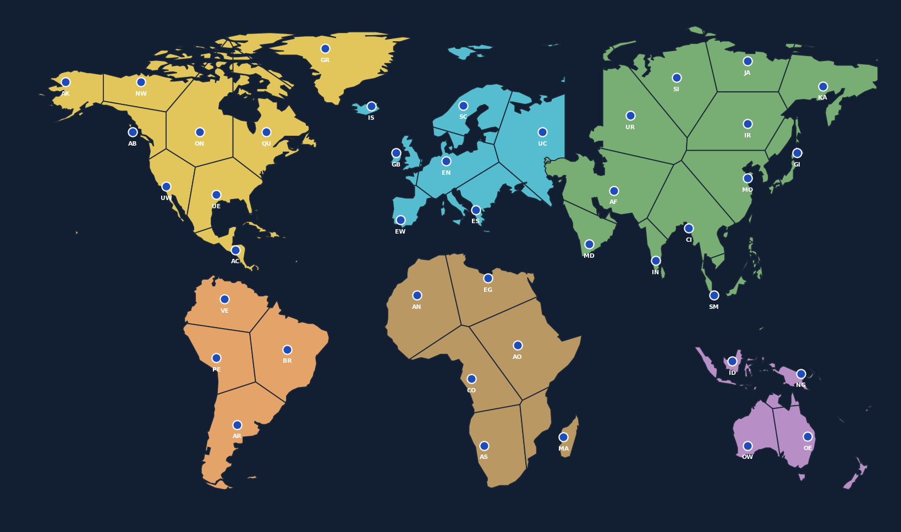

# RISIKO World – Gioco da tavolo in Python



Versione amatoriale **non ufficiale** del gioco di strategia territoriale con mappa del mondo, 42 territori, gioco contro computer con quattro difficoltà, e multiplayer su Internet tramite WebSocket.

## Funzionalità

- Mappa mondiale con coste e confini geografici, 42 territori e sei continenti.
- Gioco contro il computer: **Facile / Normale / Difficile / Esperto**.
- Multiplayer online con stanza privata e codice a 4 caratteri.
- Server WebSocket preimpostato: `wss://risiko-world-server.onrender.com`.
- Salvataggio/caricamento, carte, attacchi con dadi, rinforzi e spostamenti.
- Effetti sonori e **musica facoltativa**, se aggiungi il file `colonna_sonora.ogg` nella stessa cartella di `risiko.py`.

## Download

Vai alla sezione **Releases** del repository e scarica lo ZIP dell'ultima versione. Estrai il contenuto prima di avviare il programma.

## Installazione e avvio su Kali Linux / Linux

Richiede **Python 3.10+** e un ambiente desktop (Pygame).

```bash
cd risiko-world
python3 -m venv .venv
source .venv/bin/activate
python -m pip install -r requirements.txt
python risiko.py
```

Dagli avvii successivi:

```bash
cd risiko-world
source .venv/bin/activate
python risiko.py
```

## Windows

Con Python 3.10+ installato:

```powershell
py -m venv .venv
.venv\Scripts\Activate.ps1
python -m pip install -r requirements.txt
python risiko.py
```

## Giocare online

Il programma propone automaticamente questo server:

```
wss://risiko-world-server.onrender.com
```

1. Giocatore 1: **Online: crea una stanza**, conferma il server, scegli un nickname e comunica il codice stanza.
2. Giocatore 2: **Online: entra in una stanza**, inserisci lo stesso server e il codice della stanza.
3. Una volta collegati entrambi, giocate in tempo reale.

Il server è ospitato su un servizio gratuito e può impiegare un po' a riattivarsi dopo un periodo senza traffico. Il multiplayer attuale è **per 2 giocatori**, non una lobby pubblica.

## Comandi

- Rinforzo: clic sinistro sul proprio territorio (+1); clic destro (tutte le armate rimanenti).
- Attacco: seleziona un tuo territorio con almeno 2 armate e poi un territorio nemico confinante; clic destro per il blitz.
- Spostamento: premi «Sposta», poi origine e destinazione alleate confinanti.
- `S`: salva; `L`: carica; `H`: aiuto; `M`: effetti; `N`: musica; `C`: colori; `Esc`: menu.

## Musica e diritti

Questa distribuzione **non comprende un brano musicale**. Se possiedi i diritti necessari per redistribuire un brano, puoi aggiungerlo come `colonna_sonora.ogg`. In caso contrario puoi tenerlo solo nella tua installazione locale nei limiti consentiti dalla licenza del brano. Il gioco funziona anche senza file musicale.

## Note

- La mappa usa sagome geografiche derivate da **Natural Earth**, dati di pubblico dominio, e le adatta al tabellone.
- Questo è un progetto amatoriale **non affiliato o approvato dal produttore del gioco da tavolo**. Non utilizzare loghi o grafiche ufficiali senza autorizzazione.
- I salvataggi personali e il file `risiko_config.json` non devono essere caricati nel repository.
- Nessuna licenza open source viene concessa automaticamente dalla semplice pubblicazione su GitHub: scegliere e aggiungere una licenza esplicita solo se lo desideri.
